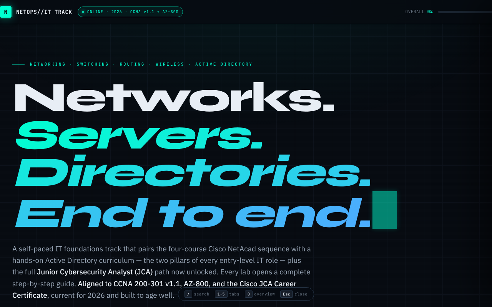
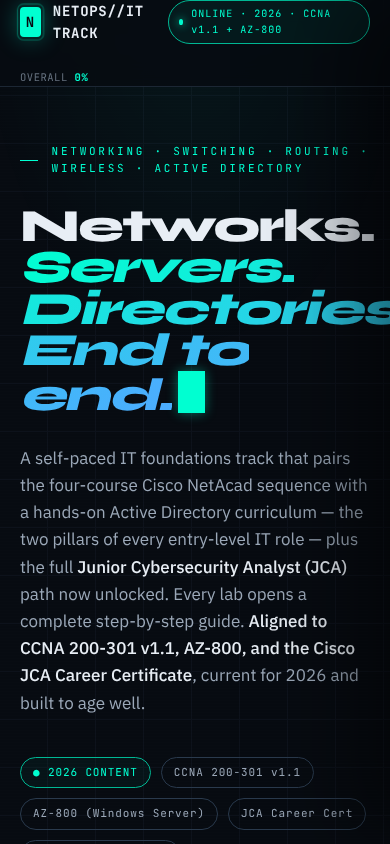

<picture>
  <source media="(prefers-color-scheme: dark)" srcset="assets/banner-dark.svg">
  
</picture>

  

  
  
  
  
  
  
  
  

  
  

A self-paced networking + systems administration curriculum tracker, built as a single-file interactive web app. Covers everything from home-network basics through enterprise switching/routing/automation to Windows Server Active Directory — aligned to **CCNA 200-301 v1.1**, **AZ-800**, and the **Cisco Junior Cybersecurity Analyst (JCA)** path.

## What's in here

| Course | Focus | Modules | Labs |
|---|---|---|---|
| **1. Networking Basics** | Home networks, Wi-Fi, IP fundamentals, basic security | 8 | 9 |
| **2. Networking Essentials** | OSI/TCP-IP, Ethernet, IPv4/IPv6 addressing & subnetting, DHCP, ARP, routing, TCP/UDP | 13 | 16 |
| **3. SRWE** (Switching, Routing & Wireless Essentials) | VLANs, inter-VLAN routing, Rapid PVST+, EtherChannel, HSRP, WLAN/WPA3, static routing | 16 | 22 |
| **4. Active Directory Foundations** | AD DS, DNS integration, OUs, GPOs, users/groups, domain-joined clients, helpdesk runbook | 9 | 9 |
| **5. ENSA** (Enterprise Networking, Security & Automation) | OSPFv2, AAA/VPN, ACLs, NAT, NTP/SNMP/Syslog, QoS, SDN, REST/Ansible automation | 10 | 13 |

**56 modules · 69 guided labs · ~269 hours** of self-paced content, each module with a written overview, learning objectives, key topics, and hands-on Packet Tracer / VirtualBox labs.

## Why a single HTML file

`index.html` is a self-contained progress tracker — no build step, no dependencies, no server. Open it in a browser, or use the live version on GitHub Pages:

- **Search & filter** every module by keyword, labs-only, CLI-only, or completion status
- **Per-lab completion tracking** saved to `localStorage` — progress persists across sessions on the same browser
- **Progress bars** per course and overall, updated live as labs are checked off
- Keyboard shortcuts: `/` to search, `1`-`4` to jump between courses, `0` for overview, `Esc` to close

Progress is stored locally in your browser only — nothing is sent anywhere, and clearing site data resets it.

## Using it

1. Open `index.html` directly, or visit the GitHub Pages link above.
2. Work through a course tab in order — each module has an overview, objectives, and one or more labs.
3. Click into a lab for the guided walkthrough, then mark it complete.
4. Courses 1–3 and 5 use **Cisco Packet Tracer** (free via the Cisco Networking Academy / Skills for All). Course 4 uses **VirtualBox** with a free 180-day Windows Server 2025 evaluation.

## Alignment

Content maps to **CCNA 200-301 v1.1** (the 2025+ exam blueprint — Rapid PVST+, WPA3, IaaS/PaaS/SaaS, cloud-managed networking) for courses 1–3 and 5, **AZ-800** (Windows Server hybrid administration) fundamentals for course 4, and the **Cisco Junior Cybersecurity Analyst (JCA)** Career Certificate.

> **AZ-800/AZ-801 were scheduled to retire on September 30, 2026** and consolidate into **AZ-802**. Course 4's content is still valid Windows Server hybrid-admin material either way; check Microsoft Learn for the current exam before you book.

> **CCNA 200-301 v1.1 retires February 2, 2027**, replaced by **v2.0** the next day. Confirmed against Cisco's own exam-topics PDF — v2.0 restructures the blueprint into five domains (not six) with a much heavier troubleshoot/diagnose emphasis, plus new topics (SFTP/SCP, storm control, RA guard, DNS-record troubleshooting, OSPFv3, agentic AI) not yet in courses 1–3/5. Courses 1–5 still target v1.1; a v2.0 content pass is a future project, not something in progress.

> **MS-900 (M365 Fundamentals) retired March 31, 2026** and can no longer be earned — dropped from the app's cert list entirely. Microsoft's loose successor is **AB-900** (Microsoft 365 Copilot and Agent Administration Fundamentals), confirmed live on Microsoft Learn but still in beta and scoped to Copilot/AI-agent admin, not general M365/Windows-Server fundamentals — not a direct swap-in for what MS-900 was doing here.

## Related

Same "Networking & Certs" category as [`ccna-tracker`](https://github.com/Cop1ouss/ccna-tracker)
(the hands-on/gamified test-prep companion to this repo's curriculum notes) and
[`secplus-tracker`](https://github.com/Cop1ouss/secplus-tracker).

## Project docs

| | |
| --- | --- |
| 📋 [PRD](docs/PRD.md) | The problem, the goal, scope and the finish line |
| 🛡️ [Security policy](SECURITY.md) | How to report a vulnerability privately |
| ⚖️ [License](LICENSE) | MIT |
| 🧪 [CI](.github/workflows/ci.yml) | What runs on every pull request |

---

Built by <a href="https://github.com/Cop1ouss">Dajoni Gomez</a> · part of the <a href="https://cop1ouss.github.io/Cop1ouss/">Uncook</a> journey log

